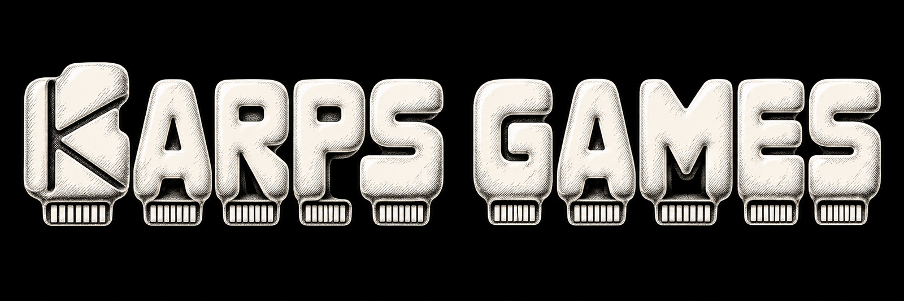

  

<b>Games and open source tools for players and modders.</b>

  
  

## Mario Kart Wii

Join the [Discord](https://discord.gg/93vfR7597T) for help, updates and to show your skins.

| | What it is | |
|---|---|---|
|  | **[MK Skin Studio](https://github.com/karps-games/mk-skin-studio)** Paint Mario Kart Wii characters in 3D with layers and export them as a mod. Windows, macOS and Linux. | [Download](https://github.com/karps-games/mk-skin-studio/releases/latest) |
|  | **MK Launcher** Play Mario Kart Wii online on PC in 4K and with the best performance, with Retro Rewind, Wiimmfi and WiiLink, plus mods and Miis. | Coming soon |
| | **Karps Engine** The Dolphin based engine that powers MK Launcher. | Coming soon |

Our Mario Kart Wii tools work with your own legally dumped copy of the game. We never include or download Nintendo files. Not affiliated with Nintendo. Mario Kart and Wii are trademarks of Nintendo.

## Chess

| | What it is | |
|---|---|---|
| | **Chengess** Change the pieces and the board on chess.com and lichess.org. | Coming soon |

Not affiliated with Chess.com or Lichess.
